# Firewall Linux, Arquitetura Netfilter & Iptables
## Relatório Técnico - Cenário: Revista Lume

**Instituto Federal Goiano - Campus Ceres**
**Curso:** Bacharelado em Sistemas de Informação
**Disciplina:** Segurança da Informação
**Docente:** Prof. Roitier Campos Gonçalves
**Aluna:** Luanna Fernandes
**Data:** 14/10/2026 (entrega: 15/10/2026)
**Repositório:** https://github.com/Luanna-f/firewall-revista-lume

---

## 1. Definição do Case

A **Revista Lume** é uma publicação mensal de moda, com edição impressa e portal digital de assinantes (empresa fictícia, criada para este trabalho). Sua sede abriga a redação, composta por editores, fotógrafos e designers, que trabalham em estações conectadas à rede interna e produzem conteúdos como editoriais e capas antes da publicação.

Para operar, a empresa depende de dois serviços:

- **Portal web:** publica as matérias e atende os assinantes. A redação também o acessa para revisar e publicar conteúdo.
- **Banco de dados:** armazena cadastros de assinantes, dados de cobrança e o acervo de conteúdos.

Por conter dados pessoais e material inédito de alto valor comercial (capas e editoriais antes do lançamento), o banco de dados é o **ativo mais crítico** da empresa e deve ser protegido contra acesso não autorizado.

---

## 2. Diagnóstico: Cenário Atual vs. Proposta de Solução

### 2.1 Cenário atual (problemas mapeados)

No cenário atual, portal, banco de dados e estações da redação compartilham a **mesma rede, sem firewall**. Os problemas mapeados foram:

| # | Problema | Risco para o negócio |
|---|----------|----------------------|
| 1 | Falta de segmentação: portal, banco e estações na mesma rede | Quem invade o portal já está na mesma rede do banco e das estações (movimentação lateral) |
| 2 | Qualquer estação alcança o banco diretamente na porta 5432 | Vazamento de dados de assinantes e de capas inéditas |
| 3 | O servidor exposto (portal) pode iniciar conexões para a rede interna | Um portal comprometido vira ponto de ataque à redação |
| 4 | Ausência de controle de acesso e de registro (log) de tentativas indevidas | Impossível detectar ou auditar varreduras e acessos suspeitos |

**Evidência do cenário atual.** Reproduzindo o ambiente sem regras (política `ACCEPT`), os testes confirmam os problemas 2 e 3:

- O `nmap` a partir da estação mostra a porta **5432 do banco aberta** (`open`).
- O `ping` partindo do servidor da DMZ para a estação interna **é respondido** (0% de perda): a DMZ alcança a rede interna.

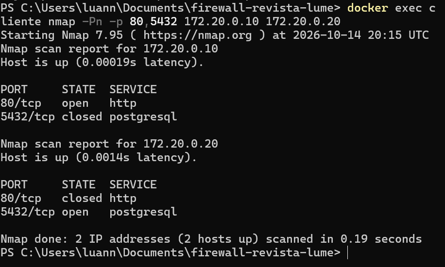

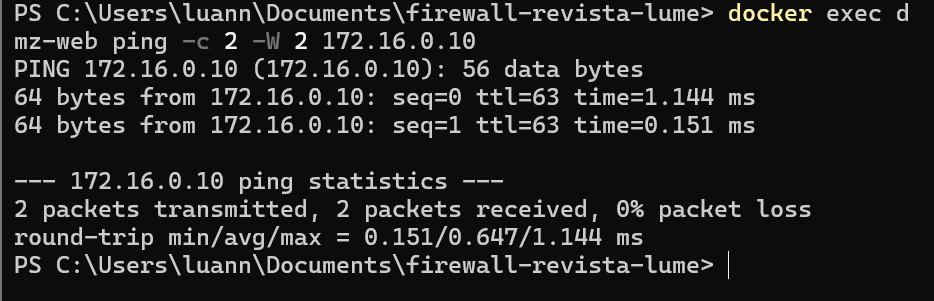

Observação técnica: nesse print o `ping` mostra `ttl=63`. O Linux inicia o TTL em 64 e cada roteador o reduz em uma unidade, o que confirma que o pacote atravessou **um salto (hop)**, o firewall, funcionando como roteador (conceito de TTL e roteamento hop-by-hop, Aula 02).

### 2.2 Proposta de solução

A solução separa a infraestrutura em duas redes e posiciona um **firewall Linux (Netfilter/iptables)** entre elas, atuando como gateway/roteador:

```
   Rede LAN (172.16.0.0/24)                  Rede DMZ (172.20.0.0/24)

   +------------------+     +--------------------+     +------------------+
   | cliente          |     | firewall           |     | dmz-web          |
   | 172.16.0.10      |-----| .254 (LAN) (DMZ) .254 ---| 172.20.0.10      |
   | (redação)        |     | iptables           |  |  | Nginx :80        |
   +------------------+     +--------------------+  |  +------------------+
                                                    |  +------------------+
                                                    +--| dmz-db           |
                                                       | 172.20.0.20      |
                                                       | Postgres :5432   |
                                                       +------------------+
```

| Container | Rede | IP | Função |
|-----------|------|----|--------|
| `cliente` | `lan` | 172.16.0.10 | Estação da redação |
| `firewall` | `lan` e `dmz` | 172.16.0.254 / 172.20.0.254 | Gateway com `NET_ADMIN` e `ip_forward=1` |
| `dmz-web` | `dmz` | 172.20.0.10 | Portal da revista |
| `dmz-db` | `dmz` | 172.20.0.20 | Banco de assinantes |

**Justificativas das decisões:**

1. **Roteamento pelo firewall.** O firewall é o único elemento ligado às duas redes. A estação e os servidores da DMZ recebem uma **rota** cujo *next hop* é o firewall (por exemplo, `ip route add 172.20.0.0/24 via 172.16.0.254` na estação), conforme os conceitos de tabela de roteamento e encaminhamento indireto da Aula 02. O encaminhamento de pacotes é habilitado com `net.ipv4.ip_forward=1`.
2. **Segmentação em DMZ.** Os serviços acessíveis (portal e banco) ficam isolados da rede interna. Seguindo a apostila (seção 11), a DMZ funciona como a "recepção do hotel": atende a quem chega, mas não tem acesso aos "quartos" (a rede da redação).
3. **Política padrão restritiva (Default DROP).** `INPUT` e `FORWARD` iniciam em `DROP` e apenas o tráfego necessário é liberado explicitamente (apostila, seção 9, princípio Zero Trust). Isso evita que uma porta aberta por engano exponha o ambiente.
4. **Firewall stateful.** O uso do estado das conexões (`NEW`, `ESTABLISHED`, `RELATED`, `INVALID`) com o módulo `state` (Aula 08 e apostila, seção 3) dispensa criar regras de "volta" para as respostas, que eram uma brecha nos firewalls stateless.
5. **Regra de ouro da DMZ.** Servidores da DMZ nunca iniciam conexão para a LAN. Se o portal for comprometido, o invasor fica restrito à DMZ (apostila, seção 11.2).
6. **DROP no acesso da LAN ao banco.** O banco é o ativo crítico e o alvo mais provável de varredura. Com `DROP`, a porta aparece como `filtered` e o scanner precisa esperar o tempo limite de cada tentativa (apostila, seção 9.1). Na prática, a varredura passou de cerca de 0,15 s (sem firewall) para 1,36 s (com firewall) nos testes.
7. **Registro (LOG).** As tentativas de acesso ao banco são registradas com a regra `LOG` e limite de taxa (`-m limit --limit 2/min`), como no laboratório 3 da apostila, evitando excesso de registros.

---

## 3. Matriz de Regras de Segurança (Firewall)

Políticas padrão: `INPUT DROP`, `FORWARD DROP`, `OUTPUT ACCEPT`.

| # | Chain | Origem | Destino | Porta/Protocolo | Ação | Justificativa do negócio |
|---|-------|--------|---------|-----------------|------|--------------------------|
| 1 | FORWARD | Qualquer | Qualquer | Estado `INVALID` | DROP | Pacotes anômalos que não pertencem a nenhuma conexão devem ser sempre descartados |
| 2 | FORWARD | Qualquer | Qualquer | Estados `ESTABLISHED,RELATED` | ACCEPT | Permite o retorno das conexões já autorizadas (firewall stateful) |
| 3 | FORWARD | DMZ (172.20.0.0/24) | Rede Cliente (172.16.0.0/24) | Qualquer, estado `NEW` | DROP | Regra de ouro: a DMZ nunca inicia conexão com a rede da redação |
| 4 | FORWARD | Rede Cliente (172.16.0.0/24) | DMZ-DB (172.20.0.20) | TCP 5432 | LOG (2/min) | Registra tentativas de acesso direto ao banco para auditoria |
| 5 | FORWARD | Rede Cliente (172.16.0.0/24) | DMZ-DB (172.20.0.20) | TCP 5432 | DROP | A estação não deve acessar o banco diretamente |
| 6 | FORWARD | Rede Cliente (172.16.0.0/24) | DMZ-Web (172.20.0.10) | TCP 80 e 443 | ACCEPT | A redação acessa o portal para revisar e publicar conteúdo |
| 7 | INPUT | Loopback (`lo`) | Firewall | Qualquer | ACCEPT | Funcionamento interno do próprio firewall |
| 8 | INPUT | Qualquer | Firewall | Estados `ESTABLISHED,RELATED` | ACCEPT | Respostas às conexões iniciadas pelo próprio firewall |
| 9 | FORWARD | Qualquer | Qualquer | Demais tráfego | DROP (política padrão) | Tudo o que não foi explicitamente liberado é bloqueado (Zero Trust) |
| 10 | INPUT | Qualquer | Firewall | Demais tráfego | DROP (política padrão) | O firewall não oferece serviços à LAN nem à DMZ |

As regras 1 a 6 correspondem às linhas 1 a 6 da chain `FORWARD` no firewall em execução (ver seção 4.4). O código está em `firewall/entrypoint.sh`, organizado nas 5 etapas do script corporativo da apostila: (1) roteamento, (2) limpeza das regras, (3) política padrão, (4) loopback e estados, (5) regras do case.

---

## 4. Metodologia de Testes e Validação

### 4.1 Pré-requisitos e subida do ambiente

Docker e Docker Compose instalados (Docker Desktop, no Windows) e o Docker em execução.

```
git clone https://github.com/Luanna-f/firewall-revista-lume.git
cd firewall-revista-lume
docker compose up -d --build
docker ps
```

Resultado esperado: 4 containers em execução (`firewall`, `cliente`, `dmz-web`, `dmz-db`).

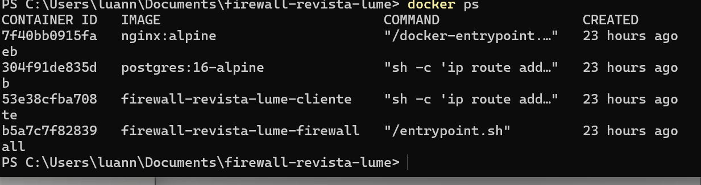

Para conferir as regras carregadas automaticamente na subida do firewall:

```
docker logs firewall
```

Resultado esperado: `ip_forward = 1`, a identificação das interfaces e a lista de regras com `policy DROP` em `INPUT` e `FORWARD`.

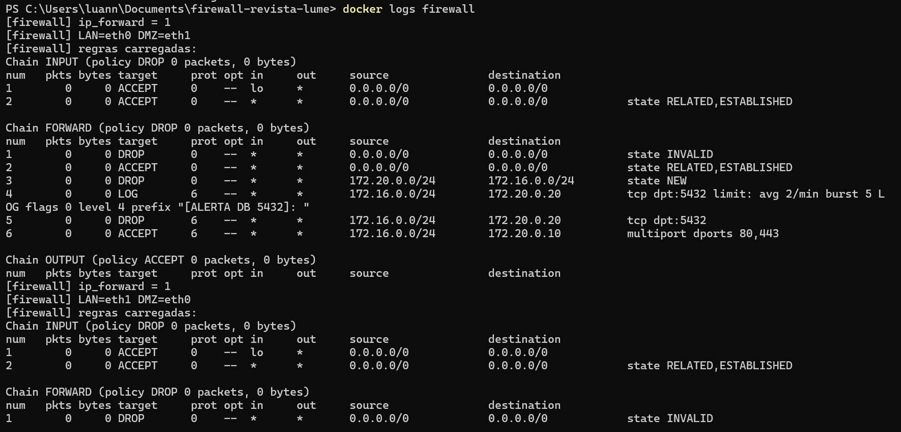

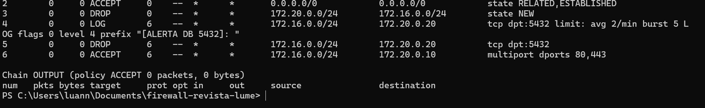

Observação: o comando `docker logs` acumula a saída de todas as execuções do container. Por isso, depois de um `restart`, as regras aparecem listadas duas vezes (uma por execução), mas o firewall limpa as regras anteriores (`iptables -F`) a cada início e não há regras duplicadas.

### 4.2 Testes positivos (o que deve funcionar)

**Teste P1: a estação da redação acessa o portal.**

```
docker exec cliente curl -s http://dmz-web
```

Esperado: o HTML da página "LUME". O nome `dmz-web` é resolvido por `extra_hosts` no container `cliente` (aponta para 172.20.0.10), pois as duas redes são separadas e o DNS do Docker não resolve nomes entre elas.

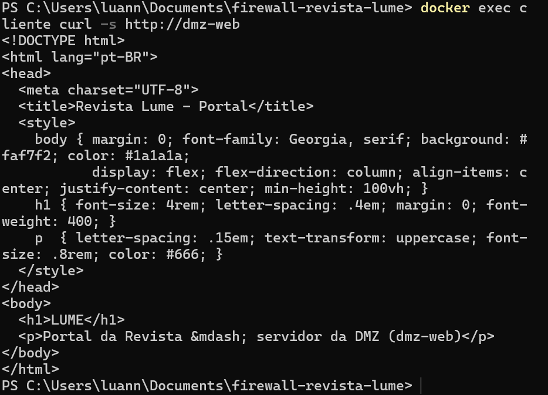

O mesmo acesso, feito pelo IP:

```
docker exec cliente curl -s http://172.20.0.10
```

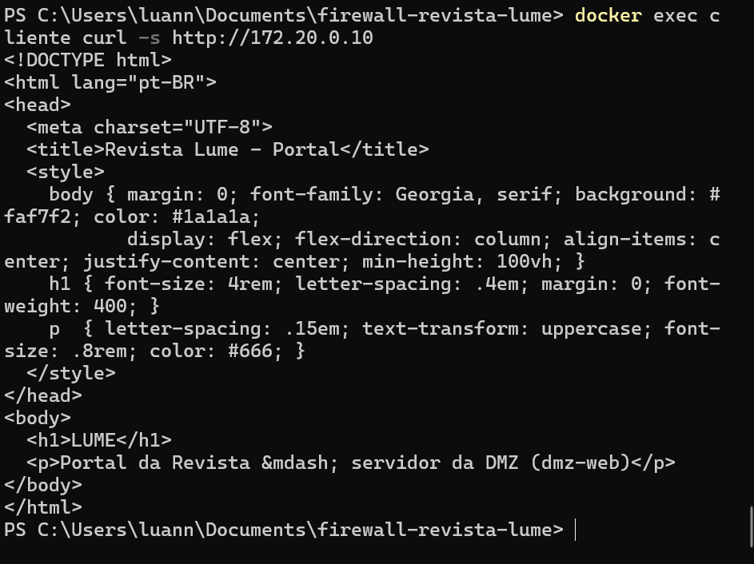

**Teste P2: a porta 80 do portal está acessível.**

```
docker exec cliente nmap -Pn -p 80,5432 172.20.0.10 172.20.0.20
```

Esperado: `80/tcp open http` no portal (172.20.0.10).

### 4.3 Testes negativos (o que deve ser bloqueado)

**Teste N1: a estação não alcança o banco de dados.** Pelo mesmo comando `nmap` do teste P2, esperado: `5432/tcp filtered` no banco (172.20.0.20), e também `filtered` nas demais portas não liberadas (porta 80 do banco e porta 5432 do portal).

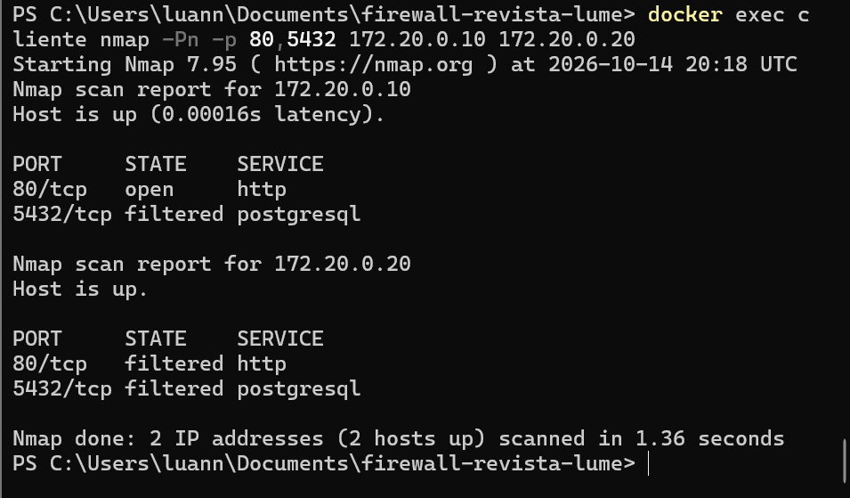

**Teste N2: a DMZ não inicia conexão com a rede interna.**

```
docker exec dmz-web ping -c 2 -W 2 172.16.0.10
```

Esperado: `100% packet loss`.

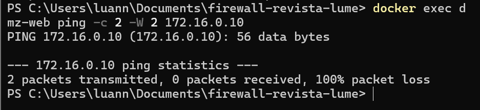

**Teste N3: isolamento de redes (o cliente só chega à DMZ passando pelo firewall).**

O teste remove da estação a rota que leva à DMZ pelo firewall e verifica que o portal deixa de ser alcançável:

```
docker exec cliente ip route
docker exec cliente ip route del 172.20.0.0/24
docker exec cliente curl -s -m 3 http://dmz-web
docker exec cliente ip route add 172.20.0.0/24 via 172.16.0.254
docker exec cliente curl -s http://dmz-web
```

Esperado:

1. `ip route` mostra a rota `172.20.0.0/24 via 172.16.0.254` (o *next hop* é o firewall).
2. Sem essa rota, o `curl` não obtém resposta (nenhum conteúdo é exibido).
3. Com a rota restaurada, a página LUME volta a ser exibida.

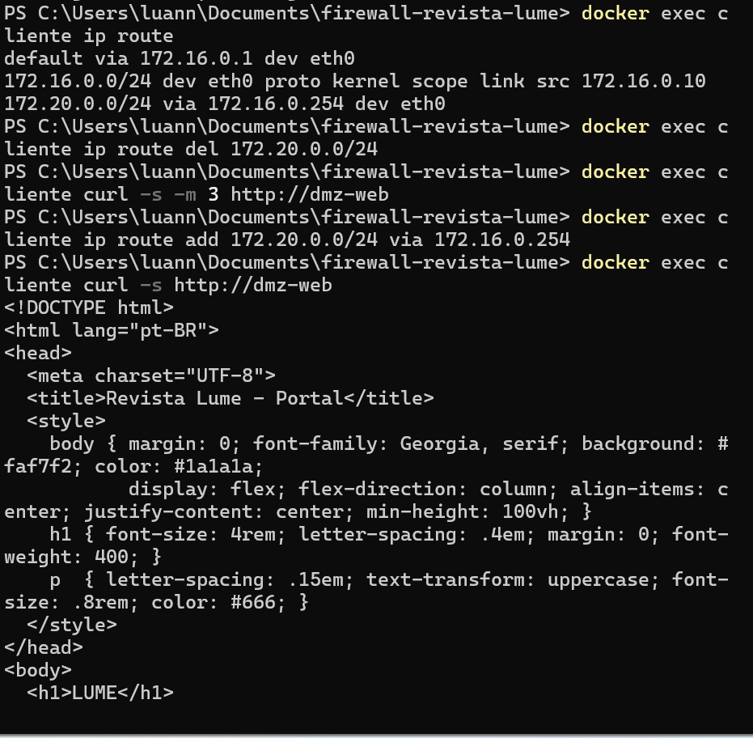

Isso mostra que a estação não tem outro caminho para a DMZ: as redes `lan` e `dmz` são `bridge` separadas e a única ligação entre elas é o firewall.

### 4.4 Evidência pelos contadores do firewall

```
docker exec firewall iptables -L FORWARD -n -v --line-numbers
```

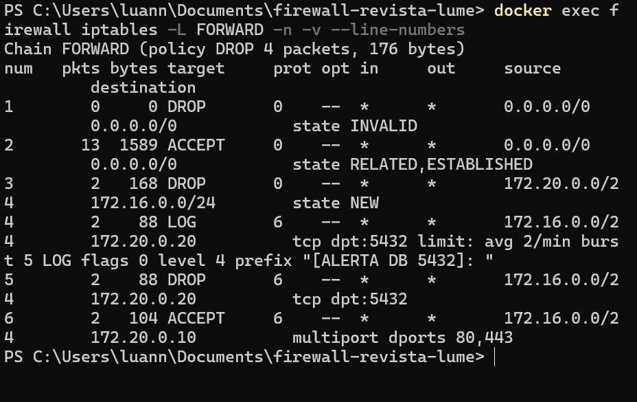

Contadores obtidos após a sequência de testes P1, P2, N1 e N2:

| Regra | Ação | Pacotes | Bytes | O que comprova |
|-------|------|---------|-------|----------------|
| 1 | DROP (INVALID) | 0 | 0 | Nenhum pacote anômalo no teste |
| 2 | ACCEPT (ESTABLISHED, RELATED) | 13 | 1589 | Respostas das conexões autorizadas passaram: firewall stateful |
| 3 | DROP (DMZ para LAN, NEW) | 2 | 168 | Os 2 pacotes do `ping` da DMZ foram bloqueados |
| 4 | LOG (LAN para banco, 5432) | 2 | 88 | As tentativas de acesso ao banco casaram com a regra de registro |
| 5 | DROP (LAN para banco, 5432) | 2 | 88 | As tentativas de acesso ao banco foram bloqueadas |
| 6 | ACCEPT (LAN para portal, 80/443) | 2 | 104 | O acesso ao portal foi liberado |
| Política | DROP (FORWARD) | 4 | 176 | Tráfego sem regra (portas 80 do banco e 5432 do portal) bloqueado pela política padrão |

### 4.5 Comparação antes e depois

| Teste | Antes (sem regras, política ACCEPT) | Depois (com o firewall) |
|-------|-------------------------------------|--------------------------|
| `nmap` ao banco, porta 5432 | `open` | `filtered` |
| `nmap` ao portal, porta 80 | `open` | `open` (liberado) |
| `nmap` ao portal, porta 5432 | `closed` | `filtered` |
| `nmap` ao banco, porta 80 | `closed` | `filtered` |
| `ping` da DMZ para a LAN | 0% de perda (respondido) | 100% de perda |
| Tempo da varredura `nmap` | 0,15 s a 0,19 s | 1,36 s |

Os estados `closed` do cenário "antes" indicam que o host respondeu (o pacote chegou ao destino); `filtered` indica que o pacote foi descartado em silêncio pelo firewall. O aumento do tempo de varredura mostra o efeito do `DROP`: o scanner espera o tempo limite de cada tentativa.

### 4.5.1 Como reproduzir o cenário "antes"

```
docker exec firewall iptables -P FORWARD ACCEPT
docker exec firewall iptables -F FORWARD
docker exec cliente nmap -Pn -p 80,5432 172.20.0.10 172.20.0.20
docker exec dmz-web ping -c 2 -W 2 172.16.0.10
```

Para restaurar as regras do firewall:

```
docker compose restart firewall
```

---

## 5. Estrutura do repositório

```
.
|-- docker-compose.yml      # redes lan/dmz, containers, NET_ADMIN e extra_hosts
|-- firewall/
|   |-- Dockerfile          # Ubuntu 24.04 + iptables
|   `-- entrypoint.sh       # carrega as regras na subida
|-- cliente/Dockerfile      # Alpine + curl, nmap, ping
|-- dmz/web/index.html      # página do portal
|-- docs/                   # este relatório e as evidências
`-- README.md               # como executar
```

---

## 6. Limitações e observações

- **Registro (LOG).** Os contadores da regra de `LOG` (2 pacotes) comprovam que ela casou com as tentativas de acesso ao banco. A leitura das mensagens no buffer do kernel (`dmesg`) não foi validada neste ambiente.
- **Tráfego interno da DMZ.** O portal e o banco estão na mesma rede (DMZ), então a comunicação entre eles não passa pelo firewall. O isolamento exigido pelo trabalho é entre a rede da redação e a DMZ.
- **Internet simulada.** O ambiente não inclui uma rede externa simulada: a "Internet" não foi representada, e o foco é o isolamento entre a LAN e a DMZ.
- **Nomes das interfaces.** Entre duas execuções do firewall, os nomes das interfaces (`eth0` e `eth1`) trocaram de posição, como mostram os logs. O script identifica as interfaces pelo endereço IP, e as regras usam endereços e redes, portanto não dependem desses nomes.
- **Credenciais.** A senha do banco no `docker-compose.yml` é fictícia e serve apenas ao laboratório.

---

## 7. Referências

Material da disciplina de Segurança da Informação, Prof. Roitier Campos Gonçalves:

- Aula 02: Introdução aos Conceitos de Roteamento (rotas, next hop, TTL, encaminhamento de pacotes).
- Aula 08: Firewall (stateless vs. stateful, Netfilter, regras, estados, chains, tabelas, iptables).
- Apostila: Firewall Linux, Arquitetura Netfilter & Iptables (política Default DROP, DROP vs. REJECT, DMZ, NAT, script corporativo e laboratórios em Docker).
- Slides: Firewall - Iptables, exemplos (comandos básicos e filtragem stateful).
